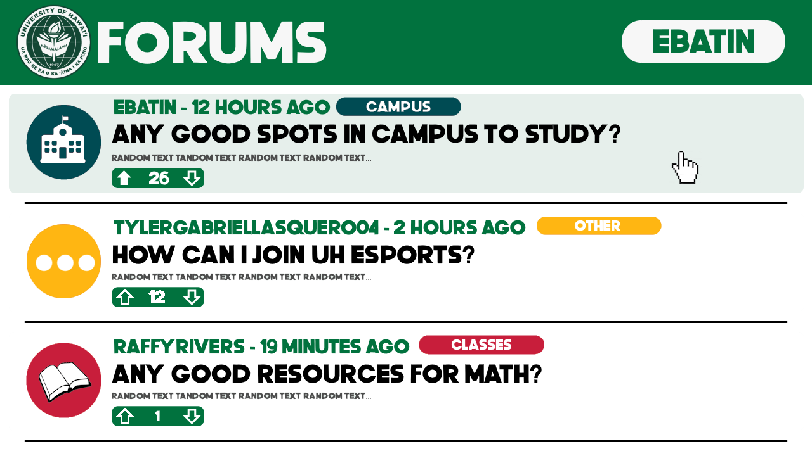
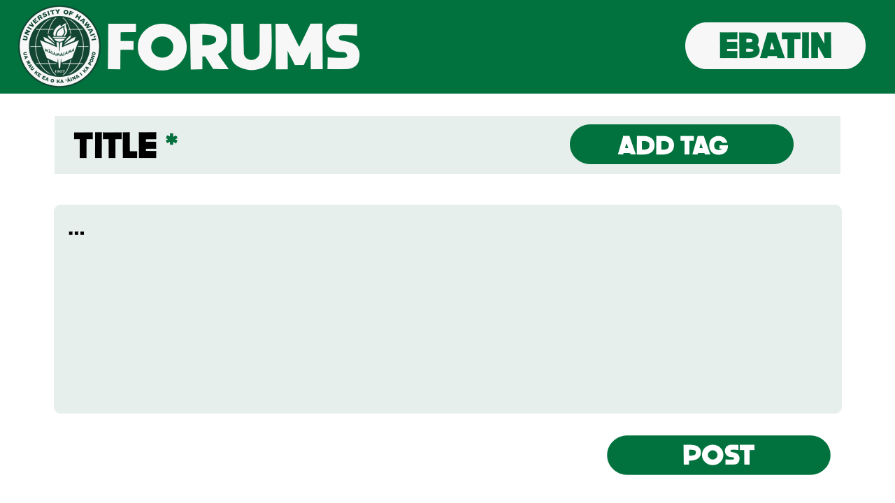
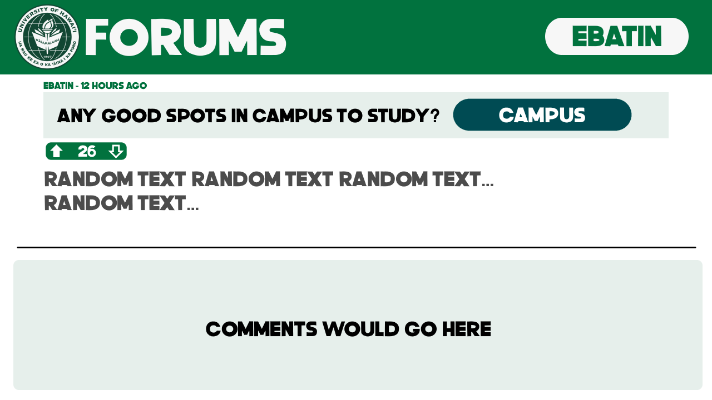

  <section class="intro-panel" aria-labelledby="overview-heading">
    
University of Hawaiʻi at Mānoa

    <h1 id="overview-heading">Overview</h1>
    
Manoa Forums is a web application where students at the University of Hawaii at Manoa can connect, share ideas, and discuss academics, campus life, and experiences across Hawaii. The platform is designed to help students ask questions, exchange advice and build a stronger campus community through open discussion.

  </section>

  <section class="content-section" aria-labelledby="project-links-heading">
    <h2 id="project-links-heading">Project Links</h2>
    <ul class="link-grid">
      <li><a href="https://github.com/manoa-ics-forum">Manoa Forums GitHub Organization</a></li>
      <li><a href="https://github.com/manoa-ics-forum/manoa-forums">Main Repository</a></li>
      <li><a href="https://github.com/manoa-ics-forum/manoa-ics-forum.github.io">Documentation Repository</a></li>
      <li><a href="https://docs.google.com/document/d/1pRgygP2X1DNKAQy31okqEMjmKfQE7118Or0AJLBuzIY/edit?usp=sharing">Team Contract</a></li>
    </ul>
  </section>

  <section class="content-section" aria-labelledby="team-heading">
    <h2 id="team-heading">The Team</h2>
    <ul class="team-list">
      <li><a href="https://github.com/ethanbatin">Ethan Batin</a></li>
      <li><a href="https://github.com/tylergabriellasquero04">Tyler Gabriel Lasquero</a></li>
      <li><a href="https://github.com/raffyrivers">Raphael Rios</a></li>
    </ul>
  </section>

  <section class="content-section mockups-section" aria-labelledby="mockups-heading">
    <h2 id="mockups-heading">Page Mockups</h2>

    <article class="mockup-card">
      <h3>Landing Page</h3>
      
The landing page explains that the forum is a place for people to connect discuss things related  to UH Manoa.

      
Users can sign in or just view the forums if they want. Viewing forums would NOT require an account, though interacting with posts does.

      <figure>
        
        <figcaption>Landing Pack Mockup by Ethan Batin</figcaption>
      </figure>
    </article>

    <article class="mockup-card">
      <h3>Sign In Page</h3>
      
Ideally we'd want people to sign in using their UH accounts so that people actually in campus can interact with posts.

      
If not though, we'll pivot and use accounts that are exclusive to the forums page, but for now, the idea is you sign in through UH.

      <figure>
        
        <figcaption>Landing Pack Mockup by Ethan Batin</figcaption>
      </figure>
    </article>

    <article class="mockup-card">
      <h3>Open Forums Page</h3>
      
This page is dedicated to showing all the posts which are sorted from most liked / most interacted with. 
      There should be features to search for posts with keywords and to search by week, month or year. 
      Posts show the author, the topic of the post, how much likes a post has, it's title and some of the contents, etc. 
      This page should also have a create post button, but I forgot to add that. 
      This example shows posts made by students but the school could also use the forums for announcements and such.

      <figure>
        
        <figcaption>Landing Pack Mockup by Ethan Batin</figcaption>
      </figure>
    </article>

    <article class="mockup-card">
      <h3>Creating Post Page</h3>
      
This page is dedicated to creating a post before publishing one. Creating a post requires an account.

      <figure>
        
        <figcaption>Landing Pack Mockup by Ethan Batin</figcaption>
      </figure>
    </article>

    <article class="mockup-card">
      <h3>Viewing Post Page</h3>
      
What viewing a post would look like

      <figure>
        
        <figcaption>Landing Pack Mockup by Ethan Batin</figcaption>
      </figure>
    </article>
  </section>

